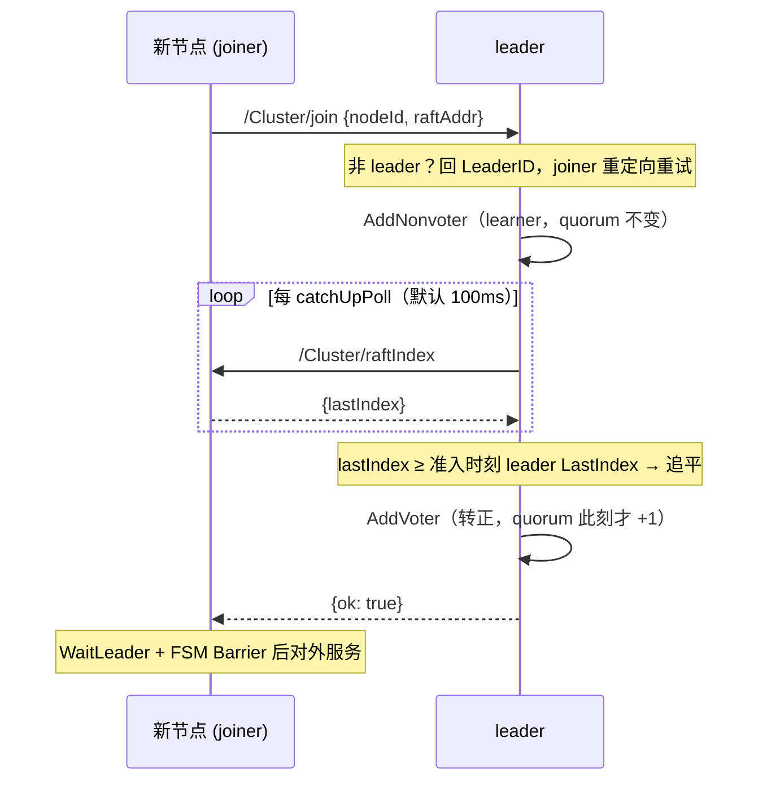

# go-nacos 集群与节点变更

本文是集群部分的专门文档：成员模型、扩容（learner 门槛 join）、缩容（remove + 自动停服）、重启语义与失败处理，附可直接运行的示例。总体架构见 [design.md](design.md)。

## 1. 成员模型

### 1.1 节点身份 = gRPC 绑定地址

一个节点只有一个对外身份：gRPC 监听地址（默认 `127.0.0.1:9848`）。它同时是：

- raft `ServerID`（成员表主键）；
- SDK 与节点间内部 RPC 的拨号地址；
- connID 前缀与临时实例归属 `originNode`。

raft `Server.Address` 仍是独立的 raft 传输地址（默认 `127.0.0.1:7848`），只做共识流量。**raft 配置表天然即集群成员表**，join 重定向、naming 同步 peer 发现都直接读它，零额外发现协议。

推论：**重启必须固定 gRPC 端口**（身份不变），且复用原数据目录。换了端口等于换了一个新节点，旧身份仍留在成员表里。

### 1.2 端口布局（对齐 Java Nacos 偏移）

| 端口 | 默认 | 用途 |
| --- | --- | --- |
| gRPC | 9848（主端口 +1000） | SDK 协议 + 内部 Cluster 服务（同端口不同 service） |
| raft | 7848（主端口 -1000） | hashicorp/raft TCP 传输，仅共识 |
| 控制台 | 8080（Nacos 3.x） | admin HTTP，读 + 有限写，`off` 禁用 |

hashicorp/raft 的 transport 只做共识，所以 join/remove/forward/sync/snapshot/raftIndex 是注册在 SDK gRPC server 上的独立 `Cluster` 服务（`internal/cluster`，Payload 信封 + JSON body），不另开端口。

### 1.3 成员表与 suffrage

成员条目带 raft `Suffrage`：`Voter`（投票成员）或 `Nonvoter`（learner，只收日志不投票）。控制台 Raft 页与 `GET /api/raft` 的 `members[].suffrage` 均可见，learner 显示为徽标。

消费成员表的四处：naming 同步 peer 列表（含 learner——它是活节点）、admin 成员展示、join 幂等校验、`watchMembership` 自停服检测。**quorum 只按 Voter 计算**。

## 2. 扩容：learner 门槛 join

### 2.1 为什么需要 learner 阶段

直接 `AddVoter` 会让 quorum 在扩容瞬间变大：1→2 节点后需要 2 票，而新节点日志还没追平，集群可用性反而下降。go-nacos 的做法是三步准入，**追平是转正的门槛**（而非 r-nacos 那种同一请求内背靠背的瞬时过渡态）：



### 2.2 追平信号：为什么是 raftIndex RPC

hashicorp/raft v1.7.3 不导出 per-peer matchIndex（`Stats()` 只有本节点指标），leader 无法直接观测"对端复制到哪了"。因此新增内部 RPC `/Cluster/raftIndex`：leader 轮询 **joiner 自身的 `LastIndex()`**（已存储的最后日志索引，语义即 matchIndex），达到准入时刻冻结的 target 即判追平。target 在 `AddNonvoter` 提交后取样，之后的新写入走正常复制，不影响门槛。

### 2.3 门槛参数与兜底

| 参数 | 默认 | 说明 |
| --- | --- | --- |
| `catchUpPoll` | 100ms | 探测周期；也是 learner 窗口的最小宽度（首次探测前先睡一个周期） |
| `catchUpTimeout` | 10s | 追平预算；**超时兜底：照样转正**并打 warn 日志（可用性优先，joiner 活着只是慢） |

代码内经 `cluster.WithCatchUp(poll, timeout)` 调整；进程内组装（e2e）经 `app.Options.JoinCatchUpPoll / JoinCatchUpTimeout`。命令行暂未暴露这两个参数。

### 2.4 边界语义

- **leader 重定向**：join 打到 follower 时回 `{leaderId}`，joiner 200ms 循环重试直到被接受（`app.join`）。gate 期间 leader 易主同样回 `LeaderID`，joiner 去新 leader 续办。
- **重启幂等**：已是 Voter 且 raft 地址相同 → 直接回 OK，不重复变更。
- **中断续 join**：joiner 在追平中途死亡/放弃 → 请求 ctx 取消，leader **不转正**，该节点留为 Nonvoter（不影响 quorum）。之后以同身份 + 同 raft 地址重新 join，从门槛处恢复直至转正。
- **地址冲突**：同 ID 但 raft 地址不同 → 拒绝（防止顶替）。
- **并发 join**：hashicorp/raft 单步单节点变更（论文 §4.1 路线），多个 join 由库内部串行化；同节点重复 join 幂等。

### 2.5 用法示例

```sh
# 首节点：无状态且未指定 -join → BootstrapCluster 自举
go run ./cmd/gonacos -data-dir ./data

# 第二节点：-join 指向任一存活节点的 gRPC 地址（不必是 leader）
go run ./cmd/gonacos \
  -listen 127.0.0.1:9858 -raft-listen 127.0.0.1:7858 \
  -admin-listen 127.0.0.1:8090 -data-dir ./data2 \
  -join 127.0.0.1:9848

# 本机 3 节点一键集群（每节点全部端口 +10，Ctrl-C 全停）
./run.sh cluster 3
```

观察 learner 窗口（日志量大时窗口更明显）：

```sh
# 成员表：新节点先以 Nonvoter 出现，追平后变 Voter
curl -s http://127.0.0.1:8080/api/raft | jq '.members'
# [
#   {"id":"127.0.0.1:9848","raftAddr":"127.0.0.1:7848","suffrage":"Voter"},
#   {"id":"127.0.0.1:9858","raftAddr":"127.0.0.1:7858","suffrage":"Nonvoter"}
# ]

# leader 日志可见两阶段：
#   cluster: learner added  node=127.0.0.1:9858 ...
#   cluster: voter added    node=127.0.0.1:9858 ... caughtUp=true
```

新节点 `Start` 返回即就绪：join 完成 → WaitLeader → FSM Barrier（尾日志回放完），可立即读写；临时实例状态另经 naming snapshot 全量拉取补齐（AP，异步收敛）。

## 3. 缩容：remove + 自动停服

### 3.1 设计

唯一入口是 admin `DELETE /api/raft/member?node=<gRPC地址>`（不做 `-leave` 命令行缩容，重启语义优先）。可在**任意节点**的控制台发起，follower 自动重定向到 leader。内部 `/Cluster/remove` 的守卫：

1. 目标缺席 → 幂等 OK；
2. 目标是最后一个 **Voter** → 拒绝（409；空配置永久无法选主）。注意只数 Voter——learner 在场不掩盖末位守卫；移除 learner 本身不受此限；
3. `RemoveServer` 单步移除，配置变更全集群提交。

移除提交后，三个机制自动收尾：

- **被移除节点自停服**：`watchMembership`（Start 成功后武装，1s tick）发现自身不在成员表 → 优雅 Stop。离线重启的旧身份节点同样据此拒绝服务。
- **naming 副本差集 sweep**：各存活节点 pingLoop 每 tick 删除 `originNode` 不在成员表的临时实例条目（`PurgeAbsentNodes`）。成员表驱动而非事件广播——自愈、零新消息；崩溃节点仍是 voter 故不触发（那是独立 ping 判死的职责，失多数派也不误清）。
- **成员表收缩**：naming peer worker 随 voter 消失退役，不再 ping、不再对账。

### 3.2 用法示例

```sh
# 在任意节点控制台移除 9858 节点（ follower 会重定向到 leader）
curl -X DELETE 'http://127.0.0.1:8090/api/raft/member?node=127.0.0.1:9858'
# {"ok":true}

# 守卫生效示例
curl -X DELETE 'http://127.0.0.1:8080/api/raft/member?node=127.0.0.1:9848'  # 单节点集群移除自己
# 409: cannot remove the last voter
curl -X DELETE 'http://127.0.0.1:8080/api/raft/member?node=127.0.0.1:1'     # 未知节点
# {"ok":true}（幂等）
```

也可在控制台 Raft 页点成员行的"移除"按钮。移除后该节点进程自动退出（日志 `app: removed from cluster, shutting down`），其临时实例在存活节点上被 sweep 清理，订阅者收到删除推送。

### 3.3 移除后重新加入

被移除节点以**原 gRPC 端口 + 原数据目录 + `-join`** 重启即可重新准入（走完整 learner 流程），naming 状态经 snapshot 拉取回填：

```sh
go run ./cmd/gonacos \
  -listen 127.0.0.1:9858 -raft-listen 127.0.0.1:7858 \
  -admin-listen 127.0.0.1:8090 -data-dir ./data2 \
  -join 127.0.0.1:9848
```

## 4. 重启与故障语义

| 场景 | 行为 |
| --- | --- |
| 正常重启（固定端口 + 原数据目录，带 `-join`） | 已是 Voter 同址 → 幂等 OK；快照 Restore + Barrier 回放尾日志后服务 |
| 重启不带 `-join` | 有状态节点直接以既有配置参与选主（单节点即自恢复）；多节点集群建议始终带 `-join` 以走幂等校验 |
| join 中途 leader 崩溃 | gate 检测到易主回 `LeaderID`，joiner 重定向续办；已写入的 Nonvoter 配置随新 leader 保留 |
| join 中途 joiner 崩溃 | 留为 Nonvoter（不转正、quorum 不变）；同身份重启续 join 恢复；也可 admin 移除这个 stranded learner |
| 追平超时（joiner 活着但慢） | 兜底转正 + warn；此后按正常 follower 复制追赶 |
| voter 崩溃（未被移除） | 仍是 voter，quorum 按原配置计算；临时实例由独立 ping 15s 判死清理（naming 保持 AP，不依赖 raft 多数派） |
| 失去多数派 | config/持久实例写不可用（CP 本色）；临时实例注册/查询/推送仍 AP 可用；`GetConfiguration` 返回最后配置，sweep 与自停服都不会误触发 |

## 5. 内部 Cluster 协议一览

注册在 SDK gRPC server（同端口），`Payload` 信封 + JSON body，全部 unary：

| 方法 | 请求 → 响应 | 用途 |
| --- | --- | --- |
| `/Cluster/join` | `{nodeId, raftAddr}` → `{ok, leaderId?, message?}` | learner 准入 + 追平转正；非 leader 回 `leaderId` |
| `/Cluster/remove` | `{nodeId}` → `{ok, leaderId?, message?}` | 缩容；缺席幂等、末位 voter 拒绝 |
| `/Cluster/forward` | `{data}` → `{data?, message?}` | follower 写转发（含 Barrier sentinel） |
| `/Cluster/sync` | naming 五种 JSON 消息 → `{ok}` | 临时实例 AP 同步（增量/对账/ping） |
| `/Cluster/snapshot` | `{}` → `{data}` | naming 全量状态拉取 |
| `/Cluster/raftIndex` | `{}` → `{lastIndex}` | join 追平门槛探测（leader → joiner） |

## 6. 与 r-nacos 的机制对照

| 维度 | go-nacos | r-nacos（async-raft-ext 0.6.3） |
| --- | --- | --- |
| 变更算法 | 单步单节点变更（hashicorp/raft，§4.1） | joint consensus（全量目标集合双阶段） |
| learner 阶段 | AddNonvoter → **matchIndex 追平门槛** → AddVoter | NodeAddr → add_non_voter → change_membership 同请求背靠背，无追平等待 |
| 追平观测 | raftIndex RPC 轮询 joiner LastIndex（库不导出 matchIndex） | 无 |
| join 健壮性 | LeaderID 重定向 + 200ms 重试循环 + 中断续 join | 直发配置 join addr，无重定向、无重试 |
| 缩容 | 专门 remove API + 末位守卫 + 差集 sweep + 自停服 | 仅通用 change-membership 全集替换，无应用层守卫与自退出 |

## 7. 容量建议与测试

- **奇数 voter**：3 节点容忍 1 故障、5 节点容忍 2；learner 不计入 quorum，扩容窗口内可用性不降。
- e2e 锁定（`e2e/cluster_test.go`）：
  - `TestClusterJoinLearnerPhase`：learner 窗口 voter 数不变、单 voter 可写、追平转正后数据齐全；
  - `TestClusterJoinLearnerResume`：joiner 中途死亡留 Nonvoter、同身份重启续 join 转正；
  - `TestClusterRemove*`：follower/leader 移除、重定向、末位守卫、移除后重 join；
  - `TestClusterNodeDeath`：失多数派下 naming 仍 AP（回归保留）。

```sh
go test ./e2e -run 'TestCluster' -v
```