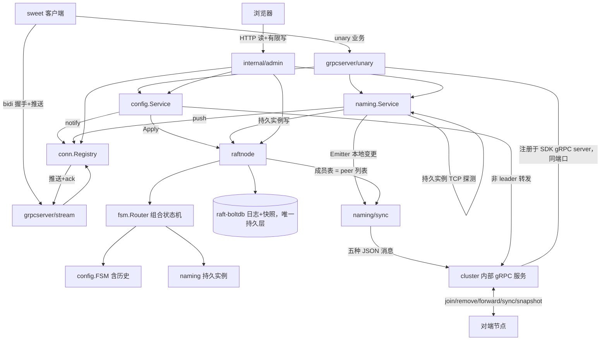

# go-nacos 设计文档

## 定位

go-nacos 是 Nacos 的 Go 原生实现：一个与官方 Nacos 2.x/3.x gRPC SDK 线级兼容的服务端，配置中心基于 raft 纯日志+快照存储。项目用于学习研究，以官方 SDK 协议兼容为准绳，以 raft 保证配置的一致性持久性。

- **不做** 1.x HTTP OpenAPI、鉴权、1.x UDP 推送；控制台为自建观测台（`internal/admin`，读 + 有限写），不复用 Java/r-nacos 的 HTTP 管理面。
- **配置中心**：hashicorp/raft 纯日志+快照存储（无额外数据文件，与 r-nacos 0.8.x / jaws-harbor 同构），写路径全部过 raft；配置历史在 FSM 内每 key 保留最近 100 版本（含当前），随快照持久化。
- **命名服务**：临时实例内存态，活性 = 连接（gRPC 模型无 beat），不过 raft，跨节点同步为连接级 AP（`internal/naming/sync`）；持久实例（ephemeral=false）注册/注销过 raft（CP），健康由每节点本地 TCP 探测维护（与 r-nacos 同构）。
- **测试客户端**：直接用 sweet（手写 Nacos 协议客户端，已对活 Nacos 3.2.3 验证），不用 nacos-sdk-go。
- Go 版本与 sweet 对齐：`go 1.27.3`，grpc `v1.84.0`，protobuf `v1.36.12`。

## 协议事实（已对 nacos 3.2.3 源码逐条验证）

| 事实 | 依据 |
| --- | --- |
| 两个无 package 的 gRPC 服务：`/Request/request`（unary）、`/BiRequestStream/requestBiStream`（bidi） | nacos_grpc_service.proto |
| 信封 `Payload{metadata{type, clientIp, headers}, body=Any}`，body 是 JSON 字节，`Any.type_url` 为空；响应只带 type 不带 clientIp | sweet envelope.go ↔ Java Payload |
| 连接身份由 TCP transport 派生（`millis_remoteIp_remotePort`），unary 与 bidi 共享同一 connectionId | AddressTransportFilter |
| 两段握手：unary `ServerCheckRequest`（免注册）→ bidi `ConnectionSetupRequest` → 服务器推 `SetupAckRequest`（abilityTable 非 null 才应答）→ 客户端回 `SetupAckResponse` | GrpcBiStreamRequestAcceptor |
| 保活 `HealthCheckRequest` 走 unary，需已注册连接 | GrpcRequestAcceptor |
| 配置不存在：resultCode=500 / errorCode=300 / "config data not exist" | ConfigQueryRequestHandler |
| CAS 冲突：resultCode=500 / errorCode=500 / 固定文案 "Cas publish fail, server md5 may have changed."；key 不存在时 CAS 直接创建 | ConfigPublishRequestHandler / AbstractCAS |
| listen 按 (groupKey, connID) 存 md5，立即应答 stale 子集；isUptodate 是字符串相等，缺失配置 md5="" | ConfigChangeBatchListenRequestHandler / ConfigCacheService |
| 变更推送 `ConfigChangeNotifyRequest` 只推 key；客户端 ack 后重新 Query + 带新 md5 重新 listen；ack 3s 超时、0/2/4s 重试、3 次未 ack 注销连接 | RpcConfigChangeNotifier |
| 命名：`InstanceRequest{type:registerInstance/deregisterInstance}`；订阅响应带初始快照；推送 `NotifySubscriberRequest{serviceInfo}` → ack `NotifySubscriberResponse`；ServiceInfo.name 非 DEFAULT_GROUP 带 "GROUP@@" 前缀 | naming handler 族 |
| Response 基类 `{resultCode:200, errorCode:0, message, requestId, success:true}`，success 是 Jackson 派生属性必须序列化 | sweet errors.go |

## 架构



| 模块 | 职责 |
| --- | --- |
| 信封类型 | 直接复用 `sweet/gen`（Payload/Metadata）；手写 ServiceDesc，不用 protoc-gen-go-grpc |
| `internal/wire` | 信封编解码 + 全部 JSON DTO（tag 与 sweet 逐字对齐） |
| `internal/conn` | 连接注册表（peer addr → connection）、推送 ack 重试、断连清理钩子；connID 带 nodeID 前缀（集群唯一） |
| `internal/fsm` | 组合 raft 状态机：Envelope 按 domain（config/naming）分发；共享 Writer（leader 直写 / follower 转发，兼作 cluster.Applier） |
| `internal/config` | 纯 raft FSM（CAS 在 Apply 内、OnChange 钩子、每 key 100 版本历史随快照）、listen/notify 服务 |
| `internal/naming` | 内存实例表（entry 带 originNode 归属）+ 独立订阅索引 + 空服务清理器，连接即活性；持久实例过 raft + 本地 TCP 探测；远端 apply 路径永不 emit |
| `internal/naming/sync` | 临时实例跨节点 AP 同步：增量广播、12s 全量对账、3s ping/15s 判死、snapshot 拉取 |
| `internal/cluster` | 内部节点间 gRPC 服务（注册在 SDK gRPC server 上，同端口）：join/remove/forward/sync/snapshot，Payload 信封 + JSON body |
| `internal/raftnode` | hashicorp/raft 组装：bolt log+stable、file snapshot、TCP transport、bootstrap/join、成员表访问器 |
| `internal/grpcserver` | 两个 ServiceDesc、unary 分发、bidi 流生命周期 |
| `internal/admin` | 观测台：独立 HTTP 端口 + embed 单页前端；读 GET-only，写限配置发布/删除 + 命名下线/删空服务 + raft 节点移除 |
| `internal/app` | 组装 + 生命周期（cmd 与 e2e 共用） |
| `e2e` | sweet 客户端驱动的端到端测试 |

## 关键设计决策

1. **连接身份 = peer addr**。对齐 Nacos "transport 派生" 思路：同一 TCP 连接上的 unary 与 bidi 天然共享身份，无需客户端回传 connectionId。
2. **流断即清理**（有意偏差）：Nacos 是 TCP 断才清理，go-nacos 在 bidi 流结束时清理。sweet 重连必重放（replay），语义等价；已用 e2e 重放测试锁定。
3. **配置写路径确定性**：CAS 判断在 FSM.Apply 内（所有节点同序执行）；时间戳由 leader 在 Command 里盖章；持久性完全由 raft 日志（raft-boltdb 同步落盘）+ 快照承担，无额外数据文件（r-nacos 0.3.7 起同构），publish 成功即可读（无 Nacos 的 dump 延迟窗口）。启动恢复 = 快照 Restore + raft Barrier 等待尾日志回放（NewRaft 只恢复快照，尾日志在重新选主后才提交回放，Start 必须 barrier 后才对外服务）。配置历史在 FSM 内每 key 保留最近 100 版本（含当前，r-nacos histories 语义），删除配置即丢历史；admin `GET /api/config/history` 可查。
4. **临时实例不过 raft（M2 定稿路线 A）**：连接级 AP 同步，与 r-nacos 同构——增量广播（per-peer 队列、失败重试一次）+ 12s 全量 connID→instances 对账（双向收敛）+ 独立 3s ping/15s 无活动判死清理 + 新节点 snapshot 全量拉取。raft 承载 config、持久实例与成员表；死亡检测不依赖 raft 成员观测，raft 失多数派时临时实例 naming 仍 AP 可用。
5. **推送 ack 完整复刻**：3s 超时、0/2/4s 重试、3 次失败注销连接；ack 唤醒后检查 closed 防误判。
6. **GracefulStop 前先退役连接**：bidi 长活流不会自己结束，直接 GracefulStop 会挂起。
7. **connectionId 加节点前缀与原子序号**：`nodeID_millis_seq_peer`，集群唯一且防同毫秒重连碰撞；deregister 仅 connID 守卫即可跨节点安全（admin 强制下线可在副本持有节点发起）。
8. **旧流清理带 ID 比对**：重连竞态下旧流的 Unregister 不会误清新连接。
9. **信封类型复用 sweet/gen，不另 vendored**：protobuf 全局注册表按 proto 文件名去重，服务端与客户端各持一份同名 `nacos_grpc_service.proto` 会在 e2e 二进制 init 时 panic（"file already registered"）。共享同一生成包既消除冲突，又让服务端/客户端线级孪生由构造保证。代价是服务端依赖 sweet 模块（仅 gen 包，纯 protobuf 类型）。
10. **观测台与 SDK 路径隔离**：Java/r-nacos 控制台各吃一套私有 HTTP 管理契约，与 gRPC-only 服务端错配，故自建。`internal/admin` 独立端口（默认 127.0.0.1:8080，对齐 Nacos 3.x 控制台端口，`off` 禁用）、embed 前端零外部依赖；读 GET-only，写仅五条路由：配置发布/删除（走 raft，编辑带 CAS、冲突 409）、命名强制下线/删空服务（不断连接、保留订阅索引）与 raft 节点移除（leader 路由、末位 voter 拒绝 409）；暂不鉴权（M3 议题），默认仅回环监听。gRPC handler 零改动。
11. **空服务清理严格对齐 Java**：订阅索引提升到 Service 顶层独立保存（对应 `ClientServiceIndexesManager` 的 publisherIndexes/subscriberIndexes 分离）；清理器 60s 周期扫描，只删无实例且最后实例变更超 60s 的服务壳（`EmptyServiceAutoCleanerV2`），不动订阅索引——清壳后新注册仍推到旧订阅者，客户端无需重连。壳上 `lastUpdated` 只在实例变更时刷新（Java：`ServiceChangedEvent` → `Service.renewUpdateTime`，订阅不刷新）。
12. **节点身份 = gRPC 地址**：raft ServerID = gRPC 绑定地址（raft Address 仍是 raft 传输地址），raft 配置表天然即成员表——Join 重定向与 naming peer 拨号零发现协议。代价：固定端口即稳定身份，重启须保持 gRPC 端口不变（生产语义；旧 data/ 目录在身份语义变更前需重建）。
13. **防回环靠结构性隔离**：远端 apply 路径（ApplyRemote*/Reconcile/PurgeNode/RestoreSnapshot）永不 emit，无需 from_sync 标志；订阅索引仅本地，远端变更只触发常规本地推送。对账双守卫：只动 originNode=对端 的条目且 connID 匹配，本地 takeover 永不被远端声明覆盖。
14. **FSM OnChange 钩子**：每节点 Apply 变更后各推本地监听者，3+ 节点 config watch 不漏、零额外 RPC；钩子在释放 FSM 锁后调用，防与 Listen 的锁序倒置。follower 读/订阅种子经 AppendEntries 异步追赶，属正常 raft 语义。
15. **内部传输复用 SDK gRPC 端口**：hashicorp/raft 的 transport 只做共识（r-nacos 自带 raft 网络层可复用，我们不能），join/forward/naming 同步是注册在 SDK gRPC server 上的独立 Cluster 服务（同端口 9848、不同 service，Java Nacos 的 server gRPC 同样多路复用），手写 ServiceDesc、复用 sweet/gen.Payload 信封 + JSON body；不另开端口，SDK 协议零改动。
16. **端口对齐 Java Nacos**：以主端口 8848 为基准的官方偏移——gRPC +1000=9848（SDK 与节点间内部 RPC 复用）、raft -1000=7848；控制台 8080（Nacos 3.x 独立控制台端口，不偏移）。Java 的 +1001=9849 服务端 gRPC 端口在 go-nacos 里不需要（内部 RPC 已并入 9848）；go-nacos 无 1.x HTTP OpenAPI，故不监听 8848 本身。
17. **节点变更（扩容/缩容）**：扩容走 learner 门槛 join——`AddNonvoter`（quorum 不变）→ 经 `/Cluster/raftIndex` 轮询 joiner LastIndex 追平（hashicorp/raft 不导出 matchIndex；默认 100ms/10s，超时兜底照样转正）→ `AddVoter`；中断留 Nonvoter、同身份续 join 恢复。缩容：内部 `/Cluster/remove` 仅 leader 执行、follower 回 LeaderID 重定向、目标缺席幂等 OK、末位 voter 拒绝（只数 Voter，learner 不掩盖守卫；配置清空即永久死亡）；admin `DELETE /api/raft/member` 是唯一入口（不做 `-leave`，重启语义优先）。naming 副本清理走**成员差集 sweep**：pingLoop 每 tick 删除 originNode 不在 voter 表的条目（`PurgeAbsentNodes`），成员表驱动而非事件广播——自愈、零新消息，与“对账兜底”一致；崩溃节点仍是 voter 故不触发，独立 ping 判死职责不变（失多数派不误清）。被移除节点 `watchMembership`（Start 成功后武装，1s tick）检测自身不在配置表即优雅 Stop 自动停服；离线重启的旧身份节点同样据此拒绝服务。设计与用法详见 [cluster.md](cluster.md)。
18. **持久实例 CP + 本地探测（对齐 r-nacos）**：`ephemeral=false` 的注册/注销是 raft 命令（fsm.DomainNaming），全节点同序 apply，重启/节点死亡后存活；条目不绑连接（connID/originNode 为空），所有 AP 同步/清理路径双向跳过持久条目（进来的持久声明忽略，本地持久条目永不被 AP 删除/覆盖），AP 全量对账与 snapshot 拉取只携带临时实例。健康状态每节点本地 TCP 探测（默认 60s 周期/1s 超时、失败重试一次，r-nacos sniffing 同构），探测结果不过 raft，只改本地 + 推订阅者；unhealthy 只标记不删除。同端点持久条目只能被 raft 命令替换，临时注册拒绝抢占；JSON 缺省 ephemeral 字段按 true 处理（Java Instance pojo 默认值）。持久实例随组合快照持久化，新节点经 raft 复制自动获得。

## 里程碑

- **M1（已完成）**：单机完整闭环——握手/保活、config CRUD+CAS+listen+notify、naming 注册/订阅/推送/断连清理、raft+bbolt 持久化、sweet e2e（含重启持久化、断线重放）。
- **观测台（已完成）**：`internal/admin` 只读控制台——config 列表/内容、naming 服务/实例/订阅者、连接列表、raft 状态；embed 单页前端 5s 自动刷新，e2e 覆盖全部接口与 405 只读校验。
- **空服务清理（已完成）**：订阅索引独立 + 60s 过期/60s 周期清理器，严格对齐 Java；e2e 锁定“清壳后新注册推到旧订阅者（无重连）”。
- **控制台写（已完成）**：配置发布/编辑（CAS）/删除、实例强制下线、删空服务；写走与 SDK 同一领域路径（e2e 验证 admin 写→SDK 查询/监听可见）；前端表单与操作按钮。
- **M2a（已完成）**：raft 组集群——首节点 BootstrapCluster、其余 Join（非 leader 重定向）、config 写 leader 路由/转发、FSM 变更钩子全节点推本地监听者、成员表暴露；e2e 锁定 follower 转发写与双向 watch。
- **M2b（已完成）**：临时实例跨节点同步——`internal/naming/sync`（增量广播/12s 对账/3s ping 15s 判死/snapshot 拉取）+ 内部 gRPC 五种 JSON 消息；e2e 锁定双节点互见+跨节点推送、杀节点 15s 内清理（raft 失多数派仍 AP）、新节点全量拉取、丢增量靠对账收敛。
- **节点移除（已完成）**：`/Cluster/remove` + admin 入口、naming 成员差集 sweep、被移除节点自动停服；e2e 锁定 follower/leader 移除、follower 重定向、末位守卫、移除后重 join，并保留失多数派 death 回归。
- **learner 门槛 join（已完成）**：扩容改为 AddNonvoter → raftIndex 探测追平 → AddVoter，quorum 只在追平后变大；超时兜底转正、中断留 Nonvoter 续 join 恢复、末位守卫只数 Voter；admin 成员表暴露 suffrage；e2e 锁定 learner 窗口 quorum 不变与中断续 join。
- **纯 raft 存储 + 持久实例（已完成）**：去掉 config.db bbolt 副本（`internal/fsm` 组合状态机，快照格式变更为 domain 信封，旧 data 目录需重建）；配置历史进 FSM 随快照（100 版本上限 + admin 查询端点）；naming 持久实例过 raft + 本地 TCP 探测，与临时实例 AP 链路完全隔离；e2e 锁定历史重启存活、持久实例断连/重启/节点死亡存活、探测翻转与 follower 转发注册。
- **M3（按需）**：鉴权、更多 ability 协商。

## 运行与测试

```sh
go mod tidy
go build ./...
./run.sh                # 单机：gRPC 9848 / raft 7848 / 控制台 8080
./run.sh cluster        # 本机 3 节点集群，每节点全部端口 +10（8080/8090/8100 ...）
# 等价的手工启动：
go run ./cmd/gonacos -data-dir ./data
# 第二个节点：-join 指向任一存活节点的 gRPC 地址（空 = bootstrap 新集群）
go run ./cmd/gonacos -listen 127.0.0.1:9858 -raft-listen 127.0.0.1:7858 -admin-listen 127.0.0.1:8090 -data-dir ./data2 -join 127.0.0.1:9848
go test ./e2e -v
```

观测台：`http://127.0.0.1:8080`（`-admin-listen off` 可禁用；读 + 有限写，暂不鉴权）。集群与节点变更（learner 门槛 join、缩容、重启语义）的设计与示例见 [cluster.md](cluster.md)。

sweet 依赖已发布的 `v1.0.1`（go.mod 无 replace，别人 clone go-nacos 后 `go test ./e2e` 即从代理拉取，无需同级 sweet）。本地开发用 gitignored 的 `go.work`（`use . ../sweet`）覆盖到本地源码；`GOWORK=off go test ./e2e` 可验证不依赖本地 sweet 的可移植路径。