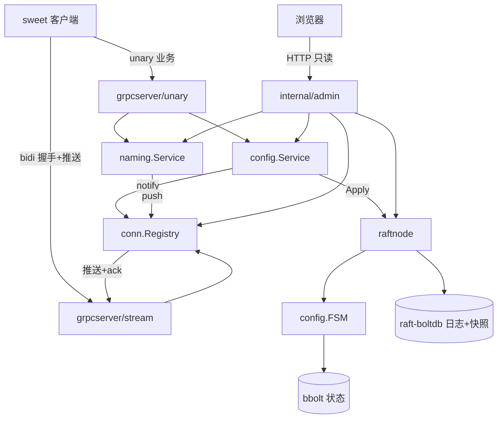

# go-nacos 设计文档

## 定位

go-nacos 是 Nacos 的 Go 原生实现：一个与官方 Nacos 2.x/3.x gRPC SDK 线级兼容的服务端，配置中心基于 raft + 嵌入式存储。目标是打造生产可用的 Go 版 Nacos，以官方 SDK 协议兼容为准绳，以 raft 保证配置的一致性持久性。

- **不做** 1.x HTTP OpenAPI、鉴权、持久实例、1.x UDP 推送；控制台为自建只读观测台（`internal/admin`），不复用 Java/r-nacos 的 HTTP 管理面。
- **配置中心**：hashicorp/raft + 嵌入式存储（bbolt），写路径全部过 raft，M1 单节点即具备完整复制/快照/恢复骨架，M2 只补 join/路由。
- **命名服务**：临时实例内存态，活性 = 连接（gRPC 模型无 beat），不过 raft（与 r-nacos 同构）。
- **测试客户端**：直接用 sweet（手写 Nacos 协议客户端，已对活 Nacos 3.2.3 验证），不用 nacos-sdk-go。
- Go 版本与 sweet 对齐：`go 1.27.3`，grpc `v1.84.0`，protobuf `v1.36.12`。

## 协议事实（已对 nacos 3.2.3 源码逐条验证）

| 事实 | 依据 |
| --- | --- |
| 两个无 package 的 gRPC 服务：`/Request/request`（unary）、`/BiRequestStream/requestBiStream`（bidi） | nacos_grpc_service.proto |
| 信封 `Payload{metadata{type, clientIp, headers}, body=Any}`，body 是 JSON 字节，`Any.type_url` 为空；响应只带 type 不带 clientIp | sweet envelope.go ↔ Java Payload |
| 连接身份由 TCP transport 派生（`millis_remoteIp_remotePort`），unary 与 bidi 共享同一 connectionId | AddressTransportFilter |
| 两段握手：unary `ServerCheckRequest`（免注册）→ bidi `ConnectionSetupRequest` → 服务器推 `SetupAckRequest`（abilityTable 非 null 才应答）→ 客户端回 `SetupAckResponse` | GrpcBiStreamRequestAcceptor |
| 保活 `HealthCheckRequest` 走 unary，需已注册连接 | GrpcRequestAcceptor |
| 配置不存在：resultCode=500 / errorCode=300 / "config data not exist" | ConfigQueryRequestHandler |
| CAS 冲突：resultCode=500 / errorCode=500 / 固定文案 "Cas publish fail, server md5 may have changed."；key 不存在时 CAS 直接创建 | ConfigPublishRequestHandler / AbstractCAS |
| listen 按 (groupKey, connID) 存 md5，立即应答 stale 子集；isUptodate 是字符串相等，缺失配置 md5="" | ConfigChangeBatchListenRequestHandler / ConfigCacheService |
| 变更推送 `ConfigChangeNotifyRequest` 只推 key；客户端 ack 后重新 Query + 带新 md5 重新 listen；ack 3s 超时、0/2/4s 重试、3 次未 ack 注销连接 | RpcConfigChangeNotifier |
| 命名：`InstanceRequest{type:registerInstance/deregisterInstance}`；订阅响应带初始快照；推送 `NotifySubscriberRequest{serviceInfo}` → ack `NotifySubscriberResponse`；ServiceInfo.name 非 DEFAULT_GROUP 带 "GROUP@@" 前缀 | naming handler 族 |
| Response 基类 `{resultCode:200, errorCode:0, message, requestId, success:true}`，success 是 Jackson 派生属性必须序列化 | sweet errors.go |

## 架构



| 模块 | 职责 |
| --- | --- |
| 信封类型 | 直接复用 `sweet/gen`（Payload/Metadata）；手写 ServiceDesc，不用 protoc-gen-go-grpc |
| `internal/wire` | 信封编解码 + 全部 JSON DTO（tag 与 sweet 逐字对齐） |
| `internal/conn` | 连接注册表（peer addr → connection）、推送 ack 重试、断连清理钩子 |
| `internal/config` | bbolt 存储、raft FSM（CAS 在 Apply 内）、listen/notify 服务 |
| `internal/naming` | 内存实例表 + 独立订阅索引 + 空服务清理器，连接即活性 |
| `internal/raftnode` | hashicorp/raft 组装：bolt log+stable、file snapshot、TCP transport、单节点 bootstrap |
| `internal/grpcserver` | 两个 ServiceDesc、unary 分发、bidi 流生命周期 |
| `internal/admin` | 只读观测台：独立 HTTP 端口 + embed 单页前端，GET-only |
| `internal/app` | 组装 + 生命周期（cmd 与 e2e 共用） |
| `e2e` | sweet 客户端驱动的端到端测试 |

## 关键设计决策

1. **连接身份 = peer addr**。对齐 Nacos "transport 派生" 思路：同一 TCP 连接上的 unary 与 bidi 天然共享身份，无需客户端回传 connectionId。
2. **流断即清理**（有意偏差）：Nacos 是 TCP 断才清理，go-nacos 在 bidi 流结束时清理。sweet 重连必重放（replay），语义等价；已用 e2e 重放测试锁定。
3. **配置写路径确定性**：CAS 判断在 FSM.Apply 内（所有节点同序执行）；时间戳由 leader 在 Command 里盖章；Apply 同步写 bbolt，publish 成功即可读（无 Nacos 的 dump 延迟窗口）。
4. **临时实例不过 raft**：与 r-nacos 一致；集群实例同步是 M2 议题（gRPC 连接级同步或 raft 皆可，届时再定）。
5. **推送 ack 完整复刻**：3s 超时、0/2/4s 重试、3 次失败注销连接；ack 唤醒后检查 closed 防误判。
6. **GracefulStop 前先退役连接**：bidi 长活流不会自己结束，直接 GracefulStop 会挂起。
7. **connectionId 加原子序号**：`millis_seq_peer`，防同毫秒重连碰撞。
8. **旧流清理带 ID 比对**：重连竞态下旧流的 Unregister 不会误清新连接。
9. **信封类型复用 sweet/gen，不另 vendored**：protobuf 全局注册表按 proto 文件名去重，服务端与客户端各持一份同名 `nacos_grpc_service.proto` 会在 e2e 二进制 init 时 panic（"file already registered"）。共享同一生成包既消除冲突，又让服务端/客户端线级孪生由构造保证。代价是服务端依赖 sweet 模块（仅 gen 包，纯 protobuf 类型）。
10. **只读观测台与 SDK 路径隔离**：Java/r-nacos 控制台各吃一套私有 HTTP 管理契约，与 gRPC-only 服务端错配，故自建。`internal/admin` 独立端口（默认 127.0.0.1:8848，`off` 禁用）、全部 GET-only（写方法 405）、embed 前端零外部依赖；领域服务只新增纯只读快照方法（`List`/`All`/`Subscribers`），gRPC handler 零改动。
11. **空服务清理严格对齐 Java**：订阅索引提升到 Service 顶层独立保存（对应 `ClientServiceIndexesManager` 的 publisherIndexes/subscriberIndexes 分离）；清理器 60s 周期扫描，只删无实例且最后实例变更超 60s 的服务壳（`EmptyServiceAutoCleanerV2`），不动订阅索引——清壳后新注册仍推到旧订阅者，客户端无需重连。壳上 `lastUpdated` 只在实例变更时刷新（Java：`ServiceChangedEvent` → `Service.renewUpdateTime`，订阅不刷新）。

## 里程碑

- **M1（已完成）**：单机完整闭环——握手/保活、config CRUD+CAS+listen+notify、naming 注册/订阅/推送/断连清理、raft+bbolt 持久化、sweet e2e（含重启持久化、断线重放）。
- **观测台（已完成）**：`internal/admin` 只读控制台——config 列表/内容、naming 服务/实例/订阅者、连接列表、raft 状态；embed 单页前端 5s 自动刷新，e2e 覆盖全部接口与 405 只读校验。
- **空服务清理（本次）**：订阅索引独立 + 60s 过期/60s 周期清理器，严格对齐 Java；e2e 锁定“清壳后新注册推到旧订阅者（无重连）”。
- **M2**：多节点——join/成员变更、写请求 leader 路由（或重定向）、临时实例跨节点同步、快照传输验证。
- **M3（按需）**：鉴权、持久实例、更多 ability 协商、metrics。

## 运行与测试

```sh
go mod tidy
go build ./...
go run ./cmd/gonacos -listen 127.0.0.1:9848 -raft-listen 127.0.0.1:9849 -admin-listen 127.0.0.1:8848 -data-dir ./data
go test ./e2e -v
```

观测台（只读）：http://127.0.0.1:8848，`-admin-listen off` 可禁用。

sweet 依赖已发布的 `v1.0.1`（go.mod 无 replace，别人 clone go-nacos 后 `go test ./e2e` 即从代理拉取，无需同级 sweet）。本地开发用 gitignored 的 `go.work`（`use . ../sweet`）覆盖到本地源码；`GOWORK=off go test ./e2e` 可验证不依赖本地 sweet 的可移植路径。